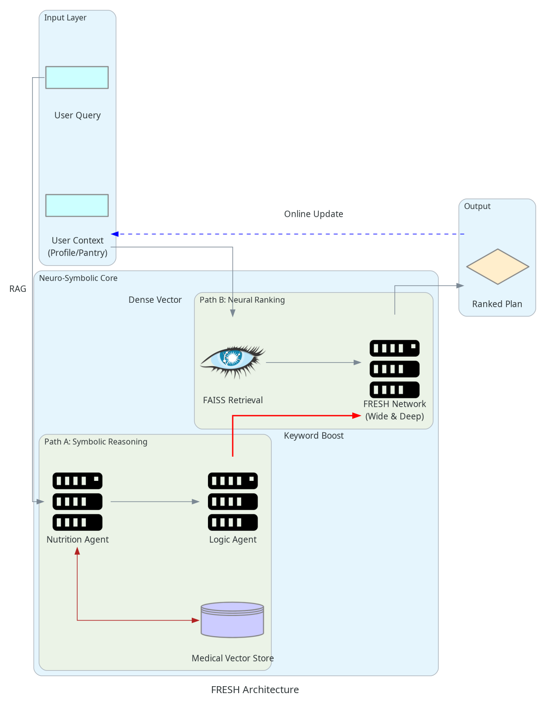

# FRESH: Food Recommendation with Explainable and Sustainable Health

FRESH plans meals that respect hard constraints (diet, allergies, medical conditions) while ranking recipes by taste, nutrition and what is already in the user's pantry. It combines a neural ranker with symbolic constraint reasoning and LLM agents, and explains each recommendation.



## How it works

A meal-plan request goes through two paths that meet at the ranker:

- **Symbolic path.** The Nutrition Agent retrieves advice from a FAISS index of nutrition literature and summarizes it with Qwen 2.5 7B (RAG). The Logic Agent turns the user's free-text request and that advice into search keywords and constraints.
- **Neural path.** Recipes are retrieved from a FAISS index of sentence-transformer embeddings and scored by `FRESH_Network`, a wide-and-deep model that fuses recipe, user-context and constraint embeddings through cross-attention.
- **Constraints.** Lagrangian soft constraint penalties (SCP) push down any recipe that violates a diet, allergy or avoidance rule, with multipliers that adapt to the observed violation rate. Whole-word keyword filters run first (so "egg" does not match "eggplant").
- **Explanations and learning.** Each recommendation comes with Shapley-value feature attributions and a short narrative. Cooking and like events update the user's taste vector online.

## Results

Ablation over regional, dietary, pantry and medical test scenarios, scored by the rule-based relevance judge in `src/fresh_metrics.py` (`notebooks/evaluation.ipynb`):

| Variant | NDCG@10 | Precision@10 |
| --- | --- | --- |
| Full model | 0.991 | 0.98 |
| Without soft constraint penalties | 0.752 | 0.58 |
| Without medical RAG (constraint vector zeroed) | 0.991 | 0.98 |
| Without pantry features | 0.991 | 0.98 |
| Embedding similarity only (no neural ranker) | 0.588 | 0.36 |

The soft constraint penalties account for most of the gain over plain embedding similarity. Removing the medical RAG or the pantry features does not change the scores on these scenarios. Per-scenario results are in `results/`, figures in `results/figures/`.

## Layout

```
src/          backend (main.py), dashboard (app.py), agents, ranker, training and evaluation
pipeline/     recipe cleaning, metadata extraction, embeddings, FAISS index, nutrition PDF ingestion,
              LLM-distilled training labels
notebooks/    evaluation and analysis
results/      evaluation tables, figures and preprocessing reports
docs/         architecture figure, API schema and example request
data/         small samples and the distilled labels; see data/README.md for the full set
legacy/       the first, rule-based version of the recommender
```

## Setup

```bash
pip install -r requirements.txt
cp .env.example .env          # GROQ_API_KEY for the LLM agents, SUPABASE_URL / SUPABASE_KEY for the dashboard
```

Build the retrieval artifacts, then start the backend and the dashboard (all commands from the repository root):

```bash
python pipeline/run_pipeline.py       # metadata, embeddings, FAISS index (needs data/full_dataset.csv)
python src/main.py                    # API on port 8001
streamlit run src/app.py              # dashboard
python src/evaluate_model.py          # evaluation suite against the running API
```

The data files are not in the repository. `data/README.md` lists what each step expects and produces.
